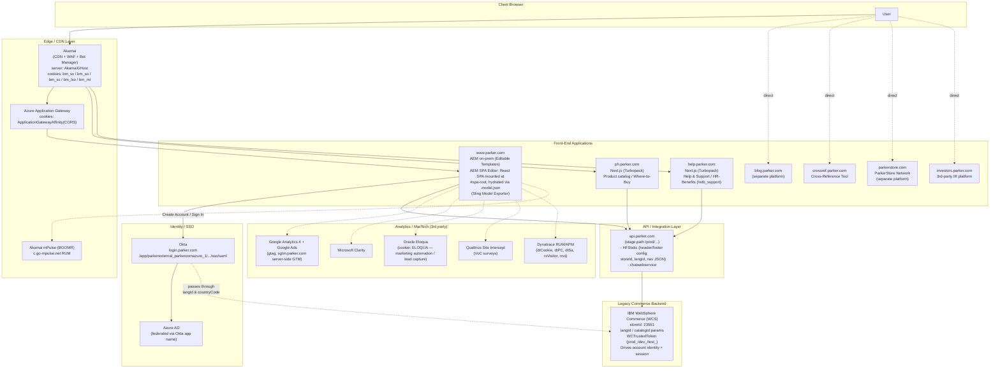

# Parker Hannifin — Current State Web Architecture (Observed)

_Reverse-engineered from public, client-side evidence only (cookies, response headers, bundle paths,
config APIs). No internal documentation or credentials were used. Last observed: 2026-10-10._

## Diagram

## Component Notes & Evidence

| Layer | Component | Role | Evidence |
|---|---|---|---|
| Edge | **Akamai** | CDN, WAF, Bot Manager — blocks non-browser/bot requests (403 on direct `curl`) | `server: AkamaiGHost` header; `bm_sv`/`bm_so`/`bm_sc`/`bm_lso`/`bm_mi` cookies (Akamai Bot Manager); `akamai-grn` header |
| Edge | **Azure Application Gateway** | Session affinity / load balancing in front of app tier | `ApplicationGatewayAffinity` / `ApplicationGatewayAffinityCORS` cookies |
| Edge | **Akamai mPulse (Boomerang/BOOMR)** | Real User Monitoring | `c.go-mpulse.net/api/config.json` request, `BOOMR_API_key` global |
| Identity | **Okta** | SAML SSO, custom domain `login.parker.com` | URL pattern `/app/{app-label}/{okta-instance-id}/sso/saml`; app label references Azure (`parkerexternal_parkercomazure_1`) |
| Frontend | **www.parker.com** | AEM on-prem, **Hybrid / SPA Editor pattern — Level 3 (full WYSIWYG integration)**. Server returns a near-empty shell (`
` + `<noscript>`); React app (bundled as an AEM clientlib) boots client-side, fetches `.model.json` (Sling Model Exporter), and maps AEM resource types to React components via the official SPA Editor SDK | Raw `fetch(location.href)` response body: `<h1 id="h1tagheader">Home</h1><noscript>You need to enable JavaScript to run this app.</noscript>

` + `<script src="/etc.clientlibs/parker-com/clientlibs/clientlib-react.min.*.js">`. Bundle contains `PageModelManager`, `ModelClient`, `MapTo` (98×), `withMappable` — i.e. `@adobe/aem-react-editable-components` + `@adobe/aem-spa-page-model-manager` (Level 3 SDK). `home.model.json` confirms `templateName: parker-homepage-template`, `componentsResourceTypes` under `parker-com/components/*` |
| Frontend | **ph.parker.com** | Product catalog, "Where to Buy" — Next.js app | `/_next/static/chunks/*.js`, Turbopack bundle names |
| Frontend | **help.parker.com** | Help & Support, HR/Benefits — Next.js app under `/wtb_support` | `/wtb_support/_next/static/chunks/*.js` |
| Frontend | **blog.parker.com**, **crossref.parker.com**, **parkerstore.com**, **investors.parker.com** | Separate subdomains/platforms, not yet fingerprinted in this session | Linked from main nav/footer only |
| API | **api.parker.com** | Gateway/BFF layer feeding frontends | `GET /prod/HFStatic/?key=divisionId:687PDC~locale:en` (header/footer nav JSON incl. `storeId`); `/prod/chatwebservice/chatDetail` |
| Legacy backend | **IBM WebSphere Commerce (WCS)** | Underlying commerce/session/identity-of-record engine | `storeId: "23551"` in HFStatic JSON; `langId=-1` cookie; `WCTrustedToken` var names (`prod_`/`dev_`/`test_` prefixed) read via `getCookie()` and fed into analytics as `user_id` |
| MarTech | GA4 / Google Ads, Microsoft Clarity, Oracle Eloqua, Qualtrics, Dynatrace | Analytics, lead-gen, VoC, APM | Script URLs + cookies: `_ga*`, `_clck`/`_clsk`, `ELOQUA`, `siteintercept.qualtrics.com`, `dtCookie`/`dtPC`/`rxVisitor` |

## Interpretation

Parker's public web presence is a **hybrid "modern front-end over legacy commerce back-end"** architecture:

- **`www.parker.com` is AEM on-prem running the official Adobe SPA Editor framework at
  Level 3 (full WYSIWYG integration)** — not a server-rendered HTL shell with isolated React
  "islands," and not a fully decoupled/headless SPA either. AEM's publish tier delivers a minimal
  HTML document (title/meta/SEO tags are server-rendered for crawlers, but the `<body>` is just an
  `<h1>` + an empty `#spa-root` mount point). A React bundle — built and deployed *as an AEM
  clientlib* (`clientlib-react.min.js`) — boots in the browser, calls the page's `.model.json`
  (Sling Model Exporter) endpoint, and uses `@adobe/aem-react-editable-components`' `MapTo()` to
  bind each AEM resource type to a React component. This is what allows authors to keep using
  AEM's drag-and-drop Page Editor against a React front end.
- `ph.parker.com` and `help.parker.com`, by contrast, are **fully decoupled Next.js apps**
  (Turbopack bundles) with no visible AEM SPA Editor SDK — consistent with Adobe's "Full SPA /
  headless" pattern rather than Level 3.
- **Identity** has been modernized to **Okta** (federating to Azure AD), decoupling login UX from
  the legacy commerce engine.
- **Commerce/session system of record is still IBM WebSphere Commerce** — `storeId`, `langId`,
  `catalogId`, and `WCTrustedToken` all persist as the backbone of account state, carried forward
  through the Okta login redirect and surfaced via the `api.parker.com` BFF layer.
- **Akamai + Azure App Gateway** form a two-tier edge (bot/WAF protection, then
  load-balancing/affinity into the Azure-hosted app tier).
- A long tail of **third-party MarTech** (GA4, Clarity, Eloqua, Qualtrics, Dynatrace, Akamai mPulse)
  is layered on top for analytics, lead capture, and performance monitoring.

## Open Questions (not yet confirmed from client-side alone)

- Whether `api.parker.com` sits in front of WCS directly or via an additional BFF/integration layer.
- Hosting location/provider for WCS itself (Azure, on-prem, or another cloud).
- Whether `blog.parker.com`, `crossref.parker.com`, `parkerstore.com`, and `investors.parker.com`
  share any backend with the core stack or are fully independent (e.g. investors.parker.com is very
  likely a third-party IR SaaS platform).
- Whether the AEM on-prem instance behind `www.parker.com` is a single shared publish farm serving
  all AEM-authored pages, or whether other sub-paths/templates still render fully server-side HTL
  without the SPA Editor shell (only the homepage template was directly confirmed in this session).
- Whether page-level AEM Core Components (non-SPA templates, if any exist) coexist with the Level 3
  SPA templates on the same instance — i.e. is this a partial/phased SPA Editor rollout, or is every
  `www.parker.com` template built this way.
