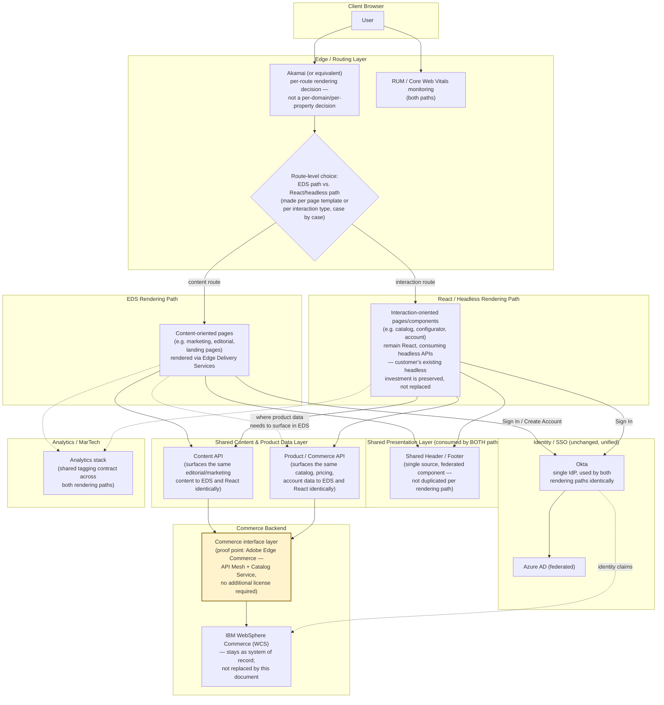

# Parker Hannifin — Future State Web Architecture (Proposed)

_Companion document to `parker-current-state-architecture.md`. This is a directional target
architecture, not a committed roadmap — every component marked "Validation Needed" requires a
proof-of-concept or technical spike before it can be treated as a decision. Drafted 2026-10-10._

_Framing note: this document intentionally does **not** presuppose that any specific existing
property (`www`, `ph`, `help`) moves to EDS. Customer IT teams are entrenched in a headless design
and a "your site becomes EDS" pitch would be (rightly) controversial. Instead, this proposes a
**bifurcated edge-routing model**: the capability to route any given page/template to either an EDS
rendering path or a React/headless rendering path, decided case-by-case — with a shared
header/footer and a shared content/product data layer so both paths stay consistent and neither
side has to duplicate data or presentation logic._

## Diagram

This is deliberately **not** a map of which existing domain (`www`, `ph`, `help`) ends up on which
path. The routing decision is made **per template or per interaction type**, and is expected to
differ team-by-team and page-by-page — the architectural point is that the *capability to route
either way* exists, with no duplication of header/footer or content/product data access between the
two paths.

## What Changes vs. Current State

| Target Component | Replaces / Evolves | Rationale | Validation Needed | Proof Point Needed |
|---|---|---|---|---|
| **Edge-level routing between EDS and React/headless paths** | Today, rendering approach is fixed per domain (`www.parker.com` = AEM SPA Editor, `ph`/`help` = Next.js) | Decouples "which rendering technology" from "which property" — lets each team/template pick EDS or React based on the actual need (content vs. interaction), without a wholesale platform migration decision | Confirm the edge/CDN layer (Akamai or successor) can route at the template/path level cleanly, and that both paths can coexist under one domain without URL-structure conflicts | Pilot: route two templates on the **same property** to different paths (e.g. one content page via EDS, one interactive page staying React) and confirm no regressions in SEO, auth, or analytics |
| **Shared Header/Footer across both paths** | Today, header/footer logic is embedded per-property (AEM clientlib on `www`, presumably components within each Next.js app on `ph`/`help`) | Avoids maintaining the same nav/footer in two+ places; ensures brand/UX consistency regardless of which rendering path serves a given page | Confirm whether a federated/shared component can be consumed identically by an EDS block and a React component (likely via a small JS web component or shared API-driven data contract, not shared framework code) | Build the header/footer as a single service (e.g. a JSON/HTML fragment API) and consume it from both an EDS block and a React component on a test page |
| **Bi-directional sharing of Content & React apps** | AEM Content can be surfaced by Next.js apps and Next.js web components can be surfaced by AEM, providing a seamless customer journey across both platforms.  | This is the core ask: let the **same** content/product data surface in either EDS or React, so the rendering-path decision doesn't fork the data model or require content to be authored/maintained twice | Confirm whether existing headless commerce/content APIs (already used by `ph`/`help`) can be the **single** source EDS also reads from — this explicitly preserves the customer IT team's existing headless investment rather than replacing it | Build one EDS block and one React component that both call the *same* content or product API endpoint and render equivalent output |
| **Identity (Okta) used identically by both paths** | Already largely true today — Okta SSO is already shared | Low-risk/no-change item; included for completeness so both rendering paths have one consistent login/account experience | Confirm session/token handling (cookies, redirects) works the same when a user crosses from an EDS-rendered page to a React-rendered page in the same session | Test a login flow starting on an EDS page and completing on a React page (or vice versa), confirm no re-authentication required |
| ⚠️ **Commerce interface layer (not a backend replacement)** | Direct, tightly-coupled calls from front-ends to IBM WebSphere Commerce (`storeId`, `langId`, `WCTrustedToken`) | An interface/mesh layer between WCS and the front-ends lets both EDS and React consume catalog/pricing/account data through one modern API contract, without touching WCS itself — directly de-risks the shared data-layer goal above by giving it a concrete implementation option | Confirm WCS exposes (or can be made to expose) the raw data these interface layers need — product/catalog/pricing/customer APIs — likely via custom resolvers/connectors since WCS isn't a natively-supported Adobe Commerce backend | **Two Adobe options to evaluate side by side:** **(1) Adobe Edge Commerce** (API Mesh + Catalog Service) — a lightweight GraphQL interface/orchestration layer that can front *any* backend, including non-Adobe systems like WCS, via custom resolvers. Requires **no additional commerce platform license** — only API Mesh/App Builder, which several Adobe customers already have access to. **Recommended first proof point** given zero incremental licensing cost. **(2) Adobe Commerce Optimizer** — a fuller SaaS storefront/merchandising layer (catalog, search, merchandising, built on Edge Delivery Services) that connects to an existing backend via a connector. More capability out of the box, but is a separately licensed product — evaluate only if Edge Commerce's thinner interface proves insufficient for the merchandising/search needs |

> ⚠️ **Highlighted row = needs discussion.** The commerce interface layer (and the choice between
> Edge Commerce and Commerce Optimizer) is the least-validated, highest-ambiguity item in this
> document and should not be treated as a settled recommendation.

## Sequencing Notes (draft, for discussion)

1. **Start with the shared data layer proof point** — build one EDS block and one React component
   against the *same* content/product API. This is the foundation the rest depends on, and it's the
   piece most likely to surface objections from customer IT if the existing headless APIs can't
   actually serve EDS cleanly.
2. **Shared header/footer** can be validated in parallel — it's lower risk and doesn't depend on the
   data-layer outcome.
3. **Edge routing pilot** (two templates on one property, split across paths) comes next, once the
   shared data layer and header/footer are proven — this is where SEO/auth/analytics parity gets
   tested end-to-end.
4. **Commerce interface layer proof point** can actually run in parallel with step 1, not strictly
   after it — standing up **Adobe Edge Commerce** (API Mesh + Catalog Service) in front of WCS as a
   read-only pilot requires no new license and doesn't touch WCS itself, so it carries little
   sequencing risk. If it proves out, it becomes the thing the shared data layer (step 1) actually
   talks to for commerce data. Adobe Commerce Optimizer is a fallback evaluation if Edge Commerce's
   thinner interface can't meet merchandising/search requirements — evaluate it second, since it
   carries its own license cost.

## Explicit Non-Goals / Open for Debate

- This document does **not** say which of `www.parker.com`, `ph.parker.com`, or `help.parker.com`
  should move to EDS, stay React, or split. That's a per-template decision made later, informed by
  the proof points above — not a conclusion of this document.
- This document does **not** ask customer IT to abandon their headless architecture. The shared
  data layer is framed as EDS becoming **another consumer** of the existing headless APIs, not a
  replacement for them.
- This document does **not** prescribe replacing WCS as the commerce system of record. It proposes
  an **interface layer** (Adobe Edge Commerce, with Adobe Commerce Optimizer as a fallback option)
  in front of WCS — WCS itself stays in place; only the data contract exposed to front-ends changes.
